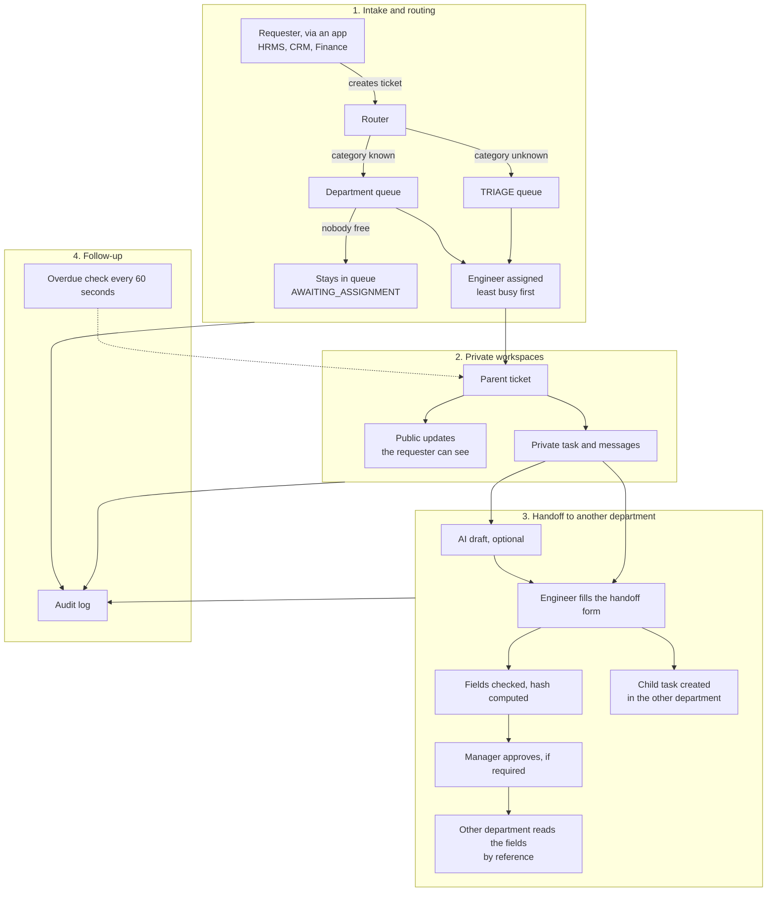
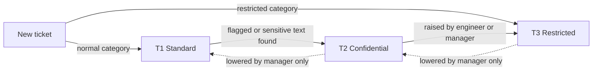
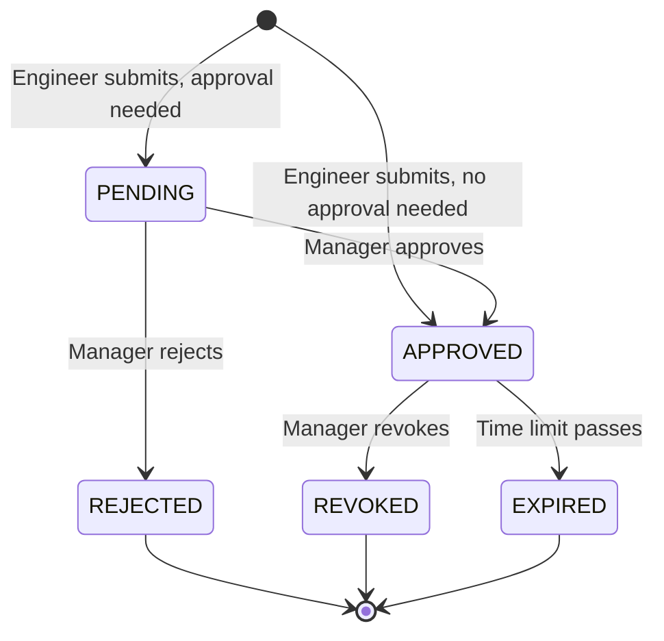
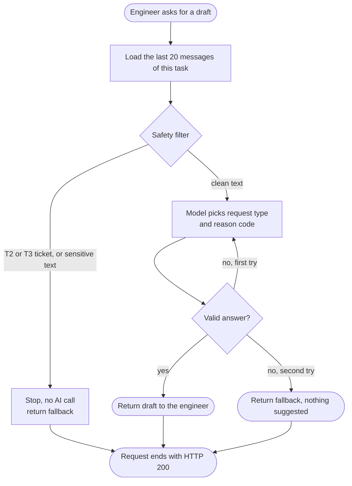
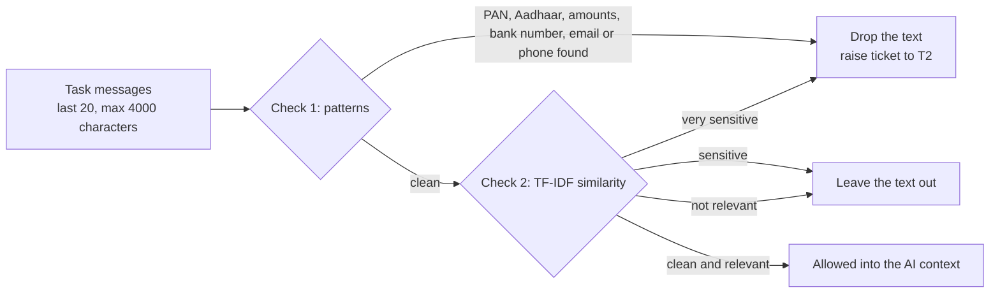
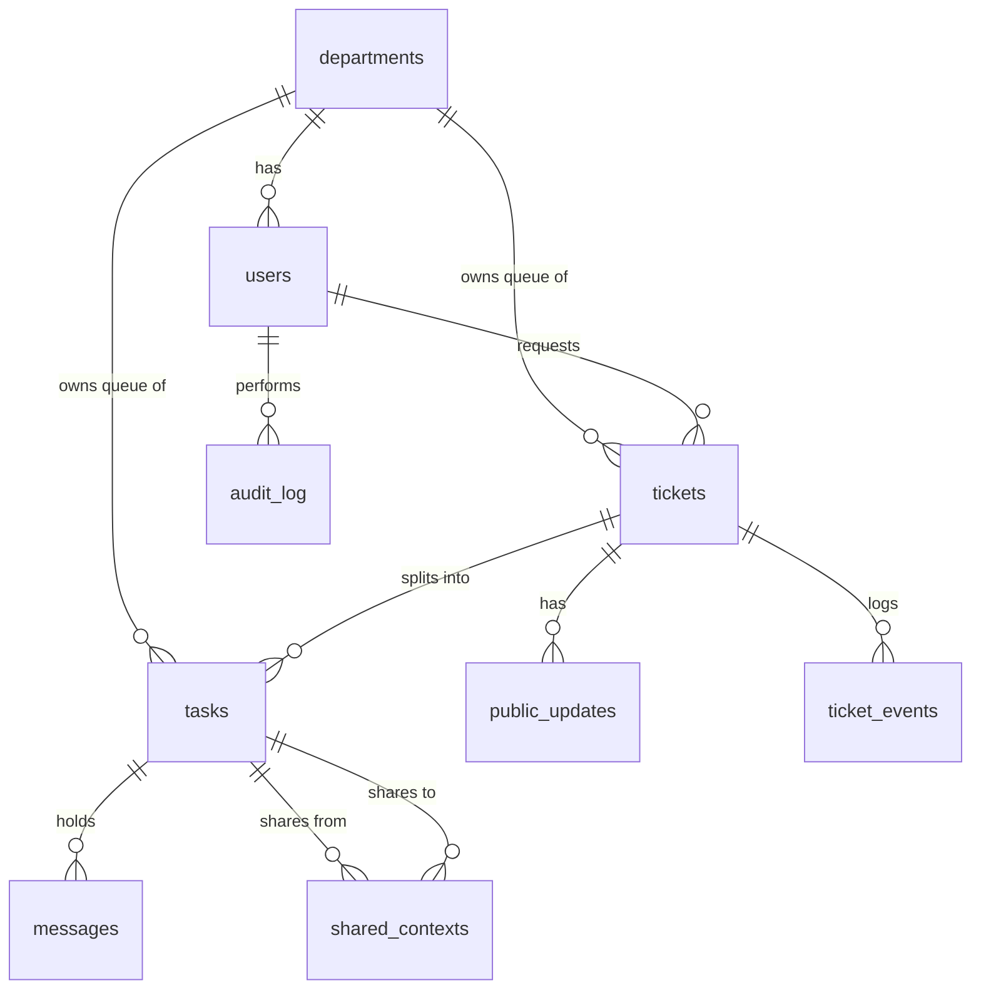

# Cross-Department Support Desk

> A ticketing system where several departments can work on one request together, without seeing each other's private discussions.

Built with Python, FastAPI and SQLite. Free and open-source tools only. Runs on a laptop with no cloud services.

---

## What problem does it solve?

In most companies, one problem touches several teams. Example: an employee reports a wrong salary deduction in the HR system. HR needs Finance to check a payment, and maybe IT to look at an error. Two things usually go wrong:

1. **Too much is visible.** Everyone on the ticket can read everything, including salary figures, complaints or personal details that other teams do not need.
2. **Information gets copied around.** Someone pastes details into another team's thread or email. Nobody controls who sees it, for how long, or whether it was changed.

This project fixes both. Every department works in its own private space, and information moves between departments only through one controlled step called a **handoff**.

## The idea in one minute

- One request is one **parent ticket**. Each department that works on it gets its own **task**.
- A task's messages are private to that department. Everyone else gets a "not found" response.
- To get help from another department, an engineer fills in a **handoff form**. The form only accepts a fixed list of fields in a fixed format (for example a job requisition number, not free text).
- Sensitive handoffs need a manager's approval. The approved content gets a fingerprint (a hash), so any later change is detected.
- Each ticket has a **confidentiality level** (T1, T2 or T3) that decides which handoffs are allowed.
- An optional **AI helper** can suggest a handoff form. It can only pick from fixed lists, never sees sensitive tickets, and never makes decisions. The system works fully without it.
- Every action, allowed or denied, is written to an **audit log**.

One rule runs through everything: **permission checks are normal code, not AI.** The AI can never grant access or lower a confidentiality level.

## Who uses it

| Role | What they can do |
|---|---|
| Requester | Create tickets. See the status and public updates of their own tickets, nothing else. |
| Engineer | Work on tasks in their department, write private messages, submit handoffs, post public updates, raise a ticket's confidentiality level. |
| Lead | Next stop when a ticket is overdue. Can close tickets they own. |
| Manager | Approve, reject or revoke their department's handoffs. Lower confidentiality levels. Run the overdue-ticket check by hand. |

---

## How it works

The diagram shows the path of a ticket from intake to close.



**Step by step**

1. **Intake.** An app calls `POST /tickets`. The router matches the app and category to a department. An unknown category goes to the TRIAGE queue, so nothing is ever unrouted. The engineer with the fewest open items is assigned. If nobody is free, the queue owns the ticket (status `AWAITING_ASSIGNMENT`), so it never sits without an owner.
2. **Work.** The engineer works in the department's private task. Other departments and the requester cannot read it. The requester only sees public updates, which a human writes.
3. **Handoff.** If another department is needed, the engineer submits a handoff (see below). This creates a child task in that department.
4. **Follow-up.** Every 60 seconds a check looks for overdue tickets and escalates them: assignee, then lead, then manager, then the TRIAGE coordinator.
5. **Close.** The parent ticket can only be closed when every child task is done.

---

## Confidentiality levels

| Level | Meaning | Set when | AI helper | Handoffs allowed | Approval |
|---|---|---|---|---|---|
| **T1** Standard | Normal ticket | Default | Allowed | To any department the request type allows | Depends on the request type |
| **T2** Confidential | Sensitive | The requester marks it confidential, sensitive text is found, or an engineer raises it | Never | Only to departments in the ticket's **audience** | Always |
| **T3** Restricted | Highest | Category is grievance, harassment, legal or security incident | Never | None. A manager handles it manually | Not applicable |

The **audience** is a list of departments allowed to be involved, chosen when the ticket is created. For example, a confidential hiring ticket can list HR and TAG only. A handoff to any other department is blocked.

Levels can be raised by an engineer or manager. Only a manager can lower them, and every change is logged.



**Why "not found" instead of "forbidden"?** If someone asks for a task they may not see, the API answers `404 Not Found`, the same answer as for a task that does not exist. This stops people from guessing IDs to find out what exists.

---

## Handoffs: what is allowed to cross between departments

A handoff is the only way data leaves a department. It has:

- a **request type** (what kind of help is needed),
- a few **fields**, each with a strict format,
- a **reason code** from a fixed list,
- an optional **note** of up to 200 characters, typed by the engineer and scanned for sensitive patterns.

Anything that does not match the allowed fields and formats is rejected with `422`.

| Request type | Goes to | Allowed fields (example values) | Approval | Expires after |
|---|---|---|---|---|
| `payroll_verification` | FIN | `deduction_ref` (DED-001234), `payroll_period` (2026-10), `txn_status` (PENDING, POSTED, FAILED or REVERSED) | Yes | 48 hours |
| `technical_diagnosis` | IT | `service_id` (SVC-1024), `error_code` (ERR-500), `time_window` (start/end timestamps) | No | 24 hours |
| `hiring_status_check` | TAG | `job_req_id` (REQ-40120), `candidate_ref` (CAND-009812), `stage` (APPLIED, SCREENING, OFFER or JOINED) | Yes | 48 hours |

### Life of a handoff



Expiry is not stored as a status. It is checked every time the handoff is read.

### How the other department reads it

The other department does not get a copy. It reads the handoff **by reference** with `GET /handoffs/{id}`, and the system re-checks everything on every read:

1. Is it approved?
2. Has it expired or been revoked?
3. Is the reading department allowed (in the ticket's audience)?
4. Does the fingerprint still match?

### The fingerprint (hash)

When a handoff is created, the system computes a SHA-256 hash over the request type, fields, reason code, note and target department. On every read it computes the hash again. If someone edited the stored data in the meantime, the hashes differ and the read is refused.

```text
payload_hash = SHA-256( request_type + fields + reason_code + note + target_department )
```

This detects changes. It does **not** encrypt the data.

---

## The AI helper (optional)

When an engineer asks for help (`POST /tasks/{id}/handoff/suggest`), a small LangGraph workflow suggests which request type and reason code fit the task. The engineer reviews and edits the draft before submitting it.



**What it does:** picks a request type and a reason code from fixed lists. Field values such as `SVC-1024` are pulled out of the messages by plain pattern matching, not written by the model.

**What it cannot do:** create tasks, approve handoffs, change confidentiality levels, read other tasks, run tools, or see T2 and T3 tickets.

**Limits:** two attempts at most, 20 seconds per call. Any failure returns a safe fallback with HTTP 200, never an error. Ticket text is passed to the model as data, with instructions to ignore any commands inside it.

**Choosing a model:** set `LLM_PROVIDER` to `none` (default, no AI), `ollama` (local model) or `gemini` (free key). If you use `gemini`, use made-up data only, because free tiers may use prompts to improve their products. All tests use a fake model, so they need no keys and no network.

---

## The safety filter

Before any text reaches the AI helper, it passes two checks:



- **Check 1, patterns** (`safety/detectors.py`): rupee amounts, PAN, 12-digit Aadhaar-like numbers, bank account numbers, emails and phone numbers. A match drops the text and raises the ticket to T2. In a handoff note, a match rejects the note with `422`.
- **Check 2, TF-IDF** (`safety/sensitivity.py`): each sentence is compared with example phrases about salary, grievances, discipline, health, legal and banking topics. TF-IDF is a classic way to turn text into numbers, and it needs no training data. Sentences that look sensitive, or unrelated to the request, are left out.

The thresholds are tuned on a small test set (`tests/data/filter_eval.json`) so that at least 95% of the sensitive sentences are caught. This filter lowers risk. It is not a guarantee (see Limitations).

---

## Data model



| Table | What it stores | Who can see it |
|---|---|---|
| `departments` | HR, FIN, IT, CRM, TAG and TRIAGE | Everyone |
| `users` | People and their roles | Used to identify the caller |
| `tickets` | The parent request: status, priority, level, audience | Requester sees the public part. The owning department sees the rest. |
| `tasks` | One unit of work per department | The owning department only |
| `messages` | Private discussion inside a task | The task's department only |
| `public_updates` | Status notes written by a human for the requester | Requester and the owning department |
| `shared_contexts` | Handoffs: fields, hash, approval, expiry | Source and target departments, under the rules above |
| `ticket_events` | Lifecycle events such as "assigned" or "escalated" (no message text) | Owning department |
| `audit_log` | Every allowed or denied call. Insert-only | Reviewers |

---

## API

Send the header `X-User-Id` with a seeded user's ID on every request. This is a prototype shortcut, not real login. The Swagger page at `/docs` lets you try every endpoint.

| ID | Endpoint | Who | What it does |
|---|---|---|---|
| E1 | `POST /tickets` | Requester | Create and route a ticket. Restricted categories become T3. |
| E2 | `GET /tickets/{id}` | Requester or owning department | Requester gets the public view. Engineers get the full view. |
| E3 | `POST /tickets/{id}/updates` | Ticket owner or assignee | Post a public update. |
| E4 | `POST /tickets/{id}/close` | Ticket owner or lead | Close the ticket. Fails while any child task is open. |
| E16 | `POST /tickets/{id}/tier` | Engineer (raise), manager (raise or lower) | Change the confidentiality level. Lowering is logged. |
| E5 | `GET /tasks/{id}` | Task's department | View a task. |
| E6 | `POST /tasks/{id}/messages` | Task's department | Add a private message. |
| E7 | `GET /tasks/{id}/messages` | Task's department | Read private messages. |
| E14 | `POST /tasks/{id}/complete` | Task assignee | Mark the task done. |
| E8 | `POST /tasks/{id}/handoff/suggest` | Task assignee | Ask the AI helper for a draft. |
| E9 | `POST /tasks/{id}/handoff` | Task assignee | Submit a handoff. Creates the child task. |
| E10 | `POST /handoffs/{id}/approve` | Source department manager | Approve a pending handoff. |
| E11 | `POST /handoffs/{id}/reject` | Source department manager | Reject a pending handoff. |
| E12 | `POST /handoffs/{id}/revoke` | Source department manager | Stop all future reads of an approved handoff. |
| E13 | `GET /handoffs/{id}` | Target department | Read the shared fields, with all checks. |
| E15 | `POST /admin/sweep` | Manager | Run the overdue-ticket check now. |

Typical responses: `200` or `201` on success, `401` for a missing or unknown user, `404` when you may not see the item, `422` for invalid input.

---

## Project structure

```text
app/
  main.py          App setup
  config.py        Routing table, request types, deadlines, escalation chain
  db.py            SQLite connection
  models.py        The 9 database tables
  seed.py          Demo departments and users
  api/             The endpoints (tickets, tasks, handoffs, admin)
  services/        Business rules: routing, assignment, permissions, handoff, overdue check, audit
  safety/          Pattern detectors, TF-IDF filter, confidentiality levels
  agent/           The AI helper: workflow, model provider, output schema
tests/             One test file per area, plus a check that every endpoint is tested
SKILL.md           Build specification used with the coding agent
requirements.txt   Python dependencies
```

---

## Run it locally

You need Python 3.11 or newer. On Windows, WSL2 works well.

```bash
git clone https://github.com/<your-username>/novintix.git
cd novintix
python3 -m venv .venv
source .venv/bin/activate        # Windows PowerShell: .venv\Scripts\activate
pip install -r requirements.txt

export LLM_PROVIDER=none         # none (default), ollama or gemini
uvicorn app.main:app --reload --port 8000
```

Open `http://localhost:8000/docs` to try the API. The seeded users and their IDs are defined in `app/seed.py`.

## Run the tests

```bash
pytest -q                                              # all tests
pytest --cov=app --cov-report=term-missing --cov-fail-under=85   # with coverage, must reach 85%
pytest tests/test_safety_filter.py -v                  # safety filter recall check
pytest tests/test_route_coverage.py -v                 # fails if any endpoint was never tested
```

Each test uses a fresh in-memory database. No test uses the network.

---

## Example: a confidential hiring question

1. An employee files a ticket from the HR system, marks it confidential, and sets the audience to HR and TAG. The router sends it to HR. The least busy HR engineer gets it. The ticket is T2.
2. The HR engineer writes private notes in the HR task. Finance, IT and the requester all get `404` if they try to read them.
3. The engineer asks for an AI draft. Because the ticket is T2, no AI call is made and a safe fallback is returned. The engineer fills in the handoff by hand: type `hiring_status_check`, `job_req_id` REQ-40120, `candidate_ref` CAND-009812.
4. The handoff is `PENDING` and a child task appears in TAG with a fixed title. TAG cannot read the fields yet. A handoff to Finance would be blocked, because Finance is not in the audience.
5. The HR manager approves. The hash is checked and the handoff becomes `APPROVED`.
6. The TAG engineer reads the fields with `GET /handoffs/{id}`. The system re-checks approval, expiry, audience and hash. TAG sees only those fields, never HR's discussion.
7. TAG completes its task. The HR engineer posts a public update ("Verification completed.") and closes the ticket.
8. The requester sees the final update and the status `CLOSED`. No internal discussion was ever exposed.

---

## Limitations

This is a prototype, built to show the design.

- **No real login.** The `X-User-Id` header stands in for single sign-on.
- **No real integrations.** Nothing connects to a real HR or finance system. Field values come from the engineer or from pattern matching.
- **No encryption.** Data sits in SQLite as plain text. The hash detects changes but does not hide anything.
- **The filter can miss things.** The TF-IDF check can miss rephrased sensitive text and text in other languages. The test set is small.
- **AI tests use a fake model.** They prove the guardrails work, not that the real model's suggestions are good.
- **Audience is fixed at creation.** There is no flow for widening it later.
- **Revoking is forward-looking.** It stops future reads but cannot undo what someone already saw.
- **No attachments, email or live notifications.**

---

## Glossary

| Term | Meaning |
|---|---|
| Parent ticket | The original request. One per issue. |
| Task (child task) | A department's piece of work on a parent ticket. |
| Queue | The department's pool of unassigned work. A ticket always has a queue, even with no engineer. |
| Handoff | The controlled way to share a few approved fields with another department. |
| Audience | The departments allowed to be involved in a confidential ticket. |
| Tier | The confidentiality level: T1, T2 or T3. |
| Hash | A fingerprint of some data. If the data changes, the fingerprint changes. |
| By reference | The other department reads the live record each time instead of getting a copy. |
| TF-IDF | A simple method that scores how much a sentence resembles example phrases. |
| LangGraph | A library for building step-by-step AI workflows with clear limits. |
| Fallback | The safe answer returned when the AI is blocked, fails or is turned off. |