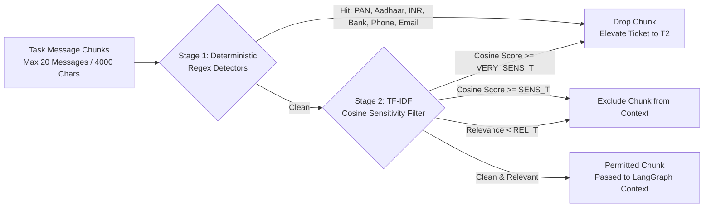
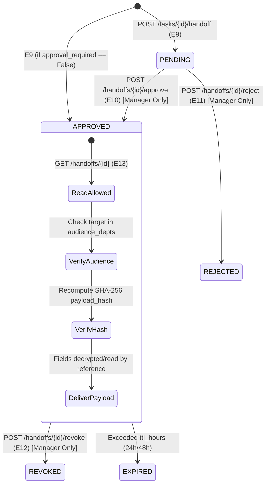
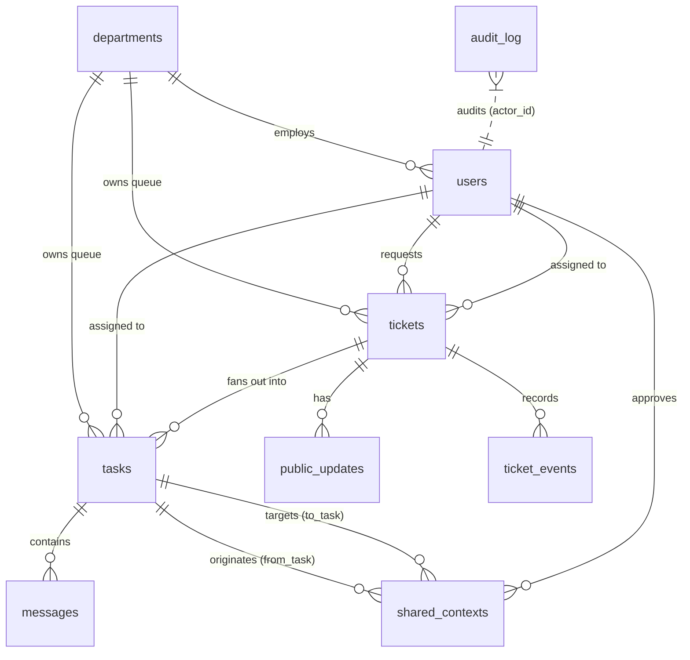

# HAESS Support Platform

**High-Assurance Enterprise Support System**  
*A deterministic, multi-tenant ticketing engine with cryptographically bound cross-department handoffs, department-isolated workspaces, and a guardrailed LangGraph assistant.*

---

## 1. Executive Summary

In complex enterprise environments (HRMS, Finance, CRM, Engineering, Recruitment), employee support issues frequently originate in one functional silo but require investigation from another. For instance, an employee raising a payroll deduction inquiry in HRMS may require confidential ledger verification by Finance and database diagnostics by IT.

Traditional service desks suffer from a fundamental security conflict:
1. **Over-privilege & Data Leakage**: Requesters or cross-department engineers gain visibility into sensitive internal discussions, compensation figures, disciplinary remarks, or regulatory PII.
2. **Context Loss & Uncontrolled Duplication**: When tickets are manually duplicated or forwarded across teams, sensitive data is scattered across uncoordinated threads without provenance, expiration, or revocation controls.

**HAESS** resolves this architectural trade-off via **Strict Compartmentalization and Deterministic Boundaries**:
- **Department-Private Workspaces**: Each department works inside isolated task queues and message logs. Requesters see only sanitized, human-curated status updates.
- **Controlled Cross-Department Handoffs**: Work crosses department boundaries through an audited, approval-gated cryptographic contract (`shared_contexts`) with strictly whitelisted schemas, regex validation, and SHA-256 payload integrity hashing.
- **Zero Probabilistic Access Control**: All authorization, audience boundary checks, tier classifications, and hash verifications are strictly deterministic Python code. AI / LLM components never grant permissions, mutate data, execute tools, or lower confidentiality tiers.
- **Closed-Set AI Assistant**: An optional LangGraph-powered co-pilot assists engineers by suggesting handoff parameters. T2/T3 tickets and sensitive context chunks are deterministically blocked from ever reaching the model.

---

## 2. High-Level System Architecture

```mermaid
flowchart TD
    subgraph Ingestion["1. Ticket Ingestion & Routing"]
        A[Enterprise App / Requester<br/>HRMS, CRM, FIN, TAG] -->|POST /tickets (E1)| B[Deterministic Router & Assignment Engine]
        B -->|Matches Routing Table| C[Department Queue<br/>HR, FIN, IT, CRM, TAG]
        B -->|Unmatched Category| D[TRIAGE Queue]
        B -->|Least-Loaded Engineer| E[Assignee Allocated]
        B -->|No Eligible Engineer| F[Queue-Owned<br/>AWAITING_ASSIGNMENT]
    end

    subgraph Workspaces["2. Department Isolation (Tiers T1, T2, T3)"]
        C --> G[Parent Ticket]
        G --> H[Department-Private Task (E5)]
        H --> I[(Private Messages E6/E7)]
        G --> J[(Public Updates E2/E3<br/>Requester-Visible)]
    end

    subgraph Handoffs["3. Cryptographic Cross-Department Handoff"]
        H -->|Draft Suggestion E8| K[LangGraph Closed-Set Agent<br/>TF-IDF & Regex Filtered]
        H -->|Engineer Submit E9| L[Handoff Contract<br/>Whitelist Regex Validation]
        L --> M[SHA-256 Payload Hash Computed]
        M -->|Approval Required| N[Source Dept Manager Approval (E10-E12)]
        N -->|Approved| O[shared_contexts Record<br/>Read-by-Reference]
        O -->|Target Dept GET /handoffs/{id} (E13)| P[Target Child Task Spawned<br/>Strict Audience & Hash Re-Check]
    end

    subgraph Governance["4. Observability & Lifecycle"]
        Q[SLA Sweeper & Escalation Loop E15] -.->|Every 60s| G
        R[Append-Only Audit Ledger] <--- Ingestion
        R <--- Workspaces
        R <--- Handoffs
    end
```

---

## 3. Core Architectural Principles & Invariants

| Principle | Technical Enforcement |
|---|---|
| **Zero Cost & Open-Source** | Built on Python 3.11+, FastAPI, SQLite (WAL mode), SQLAlchemy 2.0, Pydantic v2, scikit-learn, and LangGraph. Zero proprietary or cloud vendor lock-in. |
| **Deterministic Security Barrier** | Authentication, authorization, audience validation, tier enforcement, and cryptographic payload integrity are 100% deterministic code. |
| **Defensive ID Enumeration Prevention** | Any unauthorized attempt to view tasks, private messages, or handoffs returns `404 Not Found` (never `403 Forbidden`), preventing resource ID probing. |
| **Strict Read-by-Reference** | Shared payload fields are never duplicated into target task message logs. The target department reads data dynamically via `GET /handoffs/{id}`, which re-evaluates expiry, revocation, audience, and SHA-256 payload integrity on every access. |
| **Parent-Child Completion Locking** | A parent ticket cannot be closed (`POST /tickets/{id}/close`) while any downstream child task remains in an unfinished state. |
| **Append-Only Auditing** | Every permitted or denied API call writes an immutable record to `audit_log`. The database layer permits no runtime `UPDATE` or `DELETE` on audit tables. |

---

## 4. Confidentiality & Security Model

HAESS implements a 3-tier hierarchical confidentiality model. Tiers can be escalated automatically or manually, but can only be downgraded under strict manager-level audited authorization.

```
       [T1: Standard] ───────────────► Default operational tier
             │
             ▼ (Requester flag, PII regex hit, TF-IDF sensitivity >= VERY_SENS_T, or engineer toggle)
       [T2: Confidential] ───────────► Audience-restricted handoffs, mandatory approval, AI disabled
             │
             ▼ (RESTRICTED_CATEGORIES: GRIEVANCE, HARASSMENT, LEGAL, SECURITY_INCIDENT)
       [T3: Restricted] ─────────────► Zero handoffs permitted; manager-only manual handling, AI disabled
```

### Confidentiality Tiers Matrix

| Tier | Designation | Trigger Conditions | AI Handoff Suggestion (`E8`) | Permitted Handoff Targets | Approval Requirement |
|---|---|---|---|---|---|
| **T1** | **Standard** | Default for all standard business operations. | **Allowed** (after TF-IDF & PII scrubbing) | Any whitelisted department in `REQUEST_TYPES` | Per `REQUEST_TYPES` schema configuration |
| **T2** | **Confidential** | Requester flag at creation, regex PII hit, TF-IDF score $\ge VERY\_SENS\_T$, or engineer elevation. | **Blocked** (Zero LLM calls made; instant fallback) | Restricted strictly to `audience_depts` whitelist | **Mandatory** for all handoffs regardless of type |
| **T3** | **Restricted** | Forced for `RESTRICTED_CATEGORIES` (`GRIEVANCE`, `HARASSMENT`, `LEGAL`, `SECURITY_INCIDENT`). | **Blocked** (Zero LLM calls made; instant fallback) | **Forbidden** (Cross-department handoffs completely blocked) | N/A (Handled solely by Department Manager) |

### Tier Elevation and Lowering Rules
- **Elevation**: Any assigned engineer or department manager may elevate a ticket's tier (`T1 -> T2 -> T3`).
- **Lowering**: Only a department **manager** may lower a ticket's tier (`T3 -> T2 -> T1`). Attempts by engineers return `404`/`403`. Every tier downgrade creates an audited entry with rationale.

---

## 5. Dual-Stage Safety & Context Scrubbing

Before any ticket text reaches the optional LangGraph agent, it must pass a dual-stage, fail-closed sanitization pipeline:



1. **Stage 1: Deterministic Regex Detectors (`safety/detectors.py`)**:
   - Indian Rupee amounts (`₹`, `INR`, `Rs.`)
   - Permanent Account Number (PAN) patterns (`[A-Z]{5}[0-9]{4}[A-Z]{1}`)
   - Aadhaar 12-digit identification patterns
   - Bank account number runs
   - Corporate email addresses and telephone numbers
   *Action*: A match immediately drops the chunk and elevates the ticket to **T2 Confidential**. If detected in an engineer handoff `note`, the request is rejected with `422 Unprocessable Entity` and the ticket is elevated.

2. **Stage 2: TF-IDF Cosine Similarity Filter (`safety/sensitivity.py`)**:
   - Chunks task dialogue into sentence units.
   - Evaluates vector cosine similarity against domain seed phrases (`safety/seeds.py`: salary, grievance, disciplinary, medical, legal, banking).
   - Thresholds: `SENS_T = 0.30`, `REL_T = 0.20`, `VERY_SENS_T = 0.50`.
   - Tuned to achieve $\ge 0.95$ recall on sensitive chunks against benchmark dataset `tests/data/filter_eval.json`.

---

## 6. Cryptographic Handoff Protocol (`shared_contexts`)

Cross-department collaboration is governed by the `shared_contexts` state machine:



### Whitelisted Handoff Schemas (`REQUEST_TYPES`)

Handoff payloads reject arbitrary free-text fields. Only pre-registered, strictly validated schemas are accepted:

| Request Type | Target Dept | Permitted Whitelist Fields & Formats | Reason Codes | Approval Required | TTL |
|---|---|---|---|---|---|
| `payroll_verification` | `FIN` | `deduction_ref`: `^DED-\d{6}$`<br/>`payroll_period`: `^\d{4}-(0[1-9]\|1[0-2])$`<br/>`txn_status`: `[PENDING, POSTED, FAILED, REVERSED]` | `VERIFY_DEDUCTION`, `VERIFY_TXN` | **Yes** | 48 hrs |
| `technical_diagnosis` | `IT` | `service_id`: `^SVC-\d{4}$`<br/>`error_code`: `^ERR-\d{3,5}$`<br/>`time_window`: ISO-8601 interval format | `DIAGNOSE_ERROR` | **No** | 24 hrs |
| `hiring_status_check` | `TAG` | `job_req_id`: `^REQ-\d{5}$`<br/>`candidate_ref`: `^CAND-\d{6}$`<br/>`stage`: `[APPLIED, SCREENING, OFFER, JOINED]` | `VERIFY_STATUS`, `VERIFY_OFFER`, `DUPLICATE_CHECK` | **Yes** | 48 hrs |

### Payload Hash & Tamper-Evidence
When a handoff is created, the system calculates a canonical SHA-256 hash:
$$\text{payload\_hash} = \text{SHA256}(\text{sort}(\text{request\_type}, \text{fields\_json}, \text{reason\_code}, \text{note}, \text{target\_dept\_code}))$$
On every read via `GET /handoffs/{id}`, the hash is recalculated over the stored record. If any field has been tampered with or modified out-of-band in the database, the read fails with a security violation.

---

## 7. LangGraph Guardrailed Agent Architecture

The LangGraph co-pilot (`app/agent/graph.py`) assists engineers in drafting handoff payloads without exposing system state or allowing autonomous agency.

```mermaid
flowchart TD
    A([Start: POST /tasks/{id}/handoff/suggest]) --> B[load_context: Fetch Last 20 Msgs]
    B --> C{filter: Regex & TF-IDF Gate}
    C -->|T2/T3 or Sensitive Chunk| D[Status: Escalate / Fallback<br/>0 LLM Calls Made]
    C -->|Sanitized Context| E[propose: Invoke LLM<br/>Temperature 0.0, Closed-Set Prompt]
    E --> F{validate: validate_handoff_payload}
    F -->|Valid Schema| G([Status: OK<br/>Return Draft to Engineer])
    F -->|Invalid Schema| H{Retry Count < 1?}
    H -->|Yes| E
    H -->|No| I([Status: Fallback<br/>Return Empty Draft])
    D --> J([End: E8 Returns 200 OK])
    G --> J
    I --> J
```

### Agent Guardrail Invariants
1. **Zero Autonomy**: The agent never creates tasks, approves handoffs, or updates tickets. It returns an ephemeral JSON draft for engineer review.
2. **Zero Tool Access**: The model has no tool execution capabilities, no file system access, and no database credentials.
3. **Closed-Set Classification**: The LLM is restricted to classifying an enum of `request_type` and `reason_code`.
4. **Deterministic Field Extraction**: The LLM **never** generates field values. Field values (e.g. `SVC-1024`, `DED-001234`) are extracted solely via deterministic regex from allowed message chunks.
5. **Prompt Injection Resilience**: System prompt encapsulates ticket context strictly inside `<context>DATA</context>` boundaries with explicit instructions that context text represents passive data, never operational instructions.
6. **Hard Fault Boundaries**: Max 2 LLM invocations, strict 20-second timeout, and guaranteed fallback to HTTP 200 with `status: "fallback"` on any failure or provider error.

---

## 8. Relational Data Model (9 Core Entities)



### Database Entities Summary

| Table | Primary Purpose | Security & Privacy Scope |
|---|---|---|
| `departments` | 6 business units (`HR`, `FIN`, `IT`, `CRM`, `TAG`, `TRIAGE`). | Public metadata. |
| `users` | User directory with roles: `requester`, `engineer`, `lead`, `manager`. | Authentication identity. |
| `tickets` | Master incident records with status, priority, tier, and audience. | Public updates visible to requester; details restricted to owner department. |
| `tasks` | Department-owned units of work fanned out from a parent ticket. | Strictly private to the owning department. |
| `messages` | Collaborative conversation logs between engineers inside a task. | Isolated to task's department members (404 to all others). |
| `public_updates` | Curated status updates authored by parent ticket assignees. | Visible to the original requester and department engineers. |
| `shared_contexts` | Cryptographic contracts governing cross-department handoffs. | Accessible only by source/target departments under valid hash & approval. |
| `ticket_events` | Machine-readable lifecycle events (timestamps, transitions). | Opaque metadata events (contain no raw message text). |
| `audit_log` | Immutable append-only audit trail for compliance and security review. | System-wide, unmodifiable audit ledger. |

---

## 9. Comprehensive API Reference (Endpoints E1 – E16)

Authentication is provided via the `X-User-Id` request header (validated against seeded users).

### Ticket Management

| ID | Method & Route | Authorized Actors | Description | Response Codes |
|---|---|---|---|---|
| **E1** | `POST /tickets` | `requester` | Creates and routes a parent ticket. Determines department ownership, assigns least-loaded engineer or queues as `AWAITING_ASSIGNMENT`. Forces `T3` on restricted categories. | `201 Created`<br/>`401 Unauthorized`<br/>`422 Unprocessable` |
| **E2** | `GET /tickets/{id}` | `requester`, Owner Dept | Returns ticket details. Requesters receive a public view (status and public updates). Department engineers receive full parent metadata. | `200 OK`<br/>`401 Unauthorized`<br/>`404 Not Found` |
| **E3** | `POST /tickets/{id}/updates` | Ticket Owner / Assignee | Posts a human-authored, requester-visible status update. | `201 Created`<br/>`401 Unauthorized`<br/>`404 Not Found` |
| **E4** | `POST /tickets/{id}/close` | Ticket Owner / Lead | Marks parent ticket `CLOSED`. Fails if any child tasks remain incomplete. | `200 OK`<br/>`400 Bad Request`<br/>`404 Not Found` |
| **E16** | `POST /tickets/{id}/tier` | Engineer (raise), Manager (raise/lower) | Mutates confidentiality tier (`T1`, `T2`, `T3`). Lowering requires manager role and writes an audit event. | `200 OK`<br/>`403 Forbidden`<br/>`404 Not Found` |

### Department Workspace & Task Isolation

| ID | Method & Route | Authorized Actors | Description | Response Codes |
|---|---|---|---|---|
| **E5** | `GET /tasks/{id}` | Task Dept Members | Retrieves department-private task details. | `200 OK`<br/>`401 Unauthorized`<br/>`404 Not Found` |
| **E6** | `POST /tasks/{id}/messages` | Task Dept Members | Appends an internal, department-isolated message to the task log. | `201 Created`<br/>`401 Unauthorized`<br/>`404 Not Found` |
| **E7** | `GET /tasks/{id}/messages` | Task Dept Members | Reads the private message history of the department task. | `200 OK`<br/>`401 Unauthorized`<br/>`404 Not Found` |
| **E14** | `POST /tasks/{id}/complete` | Task Assignee | Transitions task to `DONE`. Allows optional final internal summary message. | `200 OK`<br/>`401 Unauthorized`<br/>`404 Not Found` |

### Secure Handoffs & Approvals

| ID | Method & Route | Authorized Actors | Description | Response Codes |
|---|---|---|---|---|
| **E8** | `POST /tasks/{id}/handoff/suggest` | Task Assignee | Triggers LangGraph agent to suggest structured handoff fields. Deterministic fail-closed behavior on T2/T3. | `200 OK`<br/>`401 Unauthorized`<br/>`404 Not Found` |
| **E9** | `POST /tasks/{id}/handoff` | Task Assignee | Initiates handoff. Validates whitelist schemas, checks audience, binds SHA-256 payload hash, and spawns child task. | `201 Created`<br/>`401 Unauthorized`<br/>`422 Unprocessable` |
| **E10** | `POST /handoffs/{id}/approve` | Source Dept Manager | Approves pending handoff. Verifies payload hash before signing with `approved_by`. | `200 OK`<br/>`401 Unauthorized`<br/>`404 Not Found` |
| **E11** | `POST /handoffs/{id}/reject` | Source Dept Manager | Rejects pending handoff request. | `200 OK`<br/>`401 Unauthorized`<br/>`404 Not Found` |
| **E12** | `POST /handoffs/{id}/revoke` | Source Dept Manager | Revokes an approved handoff, cutting off future reads immediately. | `200 OK`<br/>`401 Unauthorized`<br/>`404 Not Found` |
| **E13** | `GET /handoffs/{id}` | Target Dept Members | Reads shared context payload by reference. Strictly checks approval, non-expiry, non-revocation, audience, and SHA-256 integrity. | `200 OK`<br/>`401 Unauthorized`<br/>`404 Not Found` |

### System Administration & SLAs

| ID | Method & Route | Authorized Actors | Description | Response Codes |
|---|---|---|---|---|
| **E15** | `POST /admin/sweep` | Department Manager | Triggers manual SLA evaluation and escalation sweep. Evaluates assignment deadlines and task SLAs. | `200 OK`<br/>`401 Unauthorized`<br/>`403 Forbidden` |

---

## 10. Repository Organization

```
novintix/
├── app/
│   ├── main.py               # FastAPI application setup, lifecycle hooks, router registry
│   ├── config.py             # Routing rules, SLA intervals, request types, escalation chain
│   ├── db.py                 # SQLite engine, WAL configuration, Base declarative model
│   ├── models.py             # 9 SQLAlchemy relational database entities
│   ├── seed.py               # Database seeder (6 departments, ~10 role-based users)
│   ├── api/
│   │   ├── admin.py          # Admin sweep and system health endpoints (E15)
│   │   ├── handoffs.py       # Cross-department handoffs & approval endpoints (E8-E13)
│   │   ├── tasks.py          # Department-private task & messaging endpoints (E5-E7, E14)
│   │   └── tickets.py        # Master ticket lifecycle and public update endpoints (E1-E4, E16)
│   ├── services/
│   │   ├── audit.py          # Immutable append-only audit logging service
│   │   ├── assignment.py     # Least-loaded engineer allocation algorithm
│   │   ├── authz.py          # Deterministic role, department, and audience authorization
│   │   ├── handoff.py        # Payload hashing, validation, and child task creation
│   │   ├── routing.py        # Deterministic ticket category-to-department router
│   │   └── sweep.py          # SLA breach detector and hierarchical escalation runner
│   ├── safety/
│   │   ├── detectors.py      # Deterministic regex detectors (PAN, Aadhaar, INR, Banking)
│   │   ├── sensitivity.py    # TF-IDF sentence-level sensitivity and relevance filter
│   │   ├── seeds.py          # Domain seed phrases for TF-IDF cosine comparison
│   │   └── tiers.py          # Confidentiality tier transition rules and validation
│   └── agent/
│       ├── graph.py          # LangGraph state machine definition
│       ├── llm.py            # LLM provider factory (none, fake, ollama, gemini)
│       └── schemas.py        # Pydantic schemas for closed-set agent output
├── tests/
│   ├── conftest.py           # In-memory SQLite per test, as_user() client, FakeLLM fixture
│   ├── test_smoke.py         # App boot and OpenAPI schema smoke tests
│   ├── test_authz.py         # RBAC, boundary enforcement, and 404 enumeration checks
│   ├── test_tickets.py       # Ticket creation, routing, and assignment test suite
│   ├── test_handoff.py       # Cryptographic handoff, tampering, and approval tests
│   ├── test_safety_filter.py # TF-IDF sensitivity and regex detection evaluations
│   ├── test_agent_graph.py   # LangGraph execution paths and closed-set enforcement
│   └── test_route_coverage.py# Verification that 100% of registered routes are tested
├── .agent/state/
│   └── PHASE_STATE.json      # Structured state tracker for phased milestone execution
├── SKILL.md                  # Comprehensive architectural specification and phase gate rubric
├── requirements.txt          # Pinned production and test dependencies
└── README.md                 # System documentation and operational reference manual
```

---

## 11. Getting Started & Local Development

### Prerequisites
- Python 3.11+
- Virtual environment tool (`venv`)
- WSL2 (recommended on Windows environments)

### Installation

1. **Clone the repository and set up a virtual environment**:
   ```bash
   git clone https://github.com/organization/novintix.git
   cd novintix
   python3 -m venv .venv
   source .venv/bin/activate    # On Windows: .venv\Scripts\activate
   ```

2. **Install dependencies**:
   ```bash
   pip install --upgrade pip
   pip install -r requirements.txt
   ```

3. **Configure environment variables**:
   ```bash
   # Supported LLM providers: "none" (default), "ollama" (local), or "gemini" (free key)
   export LLM_PROVIDER="none"
   ```

4. **Launch the development server**:
   ```bash
   uvicorn app.main:app --host 0.0.0.0 --port 8000 --reload
   ```

5. **Access the interactive documentation**:
   - Swagger UI: `http://localhost:8000/docs`
   - ReDoc: `http://localhost:8000/redoc`

---

## 12. Verification & Testing

The platform enforces strict zero-network test isolation. Each test executes against an isolated in-memory SQLite database populated with fresh seed fixtures.

### Execute Test Suites
```bash
# Run complete test suite in quiet mode
pytest -q

# Run tests with test coverage reporting (Enforces minimum 85% coverage gate)
pytest --cov=app --cov-report=term-missing --cov-fail-under=85

# Execute safety filter recall validation on benchmark dataset
pytest tests/test_safety_filter.py -v
```

### Route Coverage Verification
Every HTTP endpoint defined in the system must be covered by functional integration tests. Run the automated route auditor:
```bash
pytest tests/test_route_coverage.py -v
```

---

## 13. End-to-End Operational Walkthrough

A representative cross-department scenario demonstrating confidentiality isolation, handoff integrity, and public status updates:

1. **Ticket Ingestion (Confidential HR & TAG scope)**:
   A candidate filing an inquiry via HRMS triggers `POST /tickets` with category `HIRING_QUERY`, `confidential=True`, and `audience_depts=["HR", "TAG"]`.
   - *Outcome*: Ticket assigned to least-loaded HR engineer. Tier set to `T2 Confidential`.

2. **Isolated Investigation in HR Workspace**:
   HR engineer logs private notes regarding candidate salary negotiations via `POST /tasks/{id}/messages`.
   - *Outcome*: Messages are strictly isolated. Inquiries from IT, Finance, or Requester return `404 Not Found`.

3. **Handoff Suggestion & Submission**:
   HR engineer requests an AI draft via `POST /tasks/{id}/handoff/suggest`.
   - *Outcome*: Because ticket is `T2`, the agent deterministically aborts LLM invocation and returns a safe fallback.
   - Engineer manually structures the handoff via `POST /tasks/{id}/handoff` (`request_type="hiring_status_check"`, target `TAG`, `job_req_id="REQ-40120"`, `candidate_ref="CAND-009812"`). Status is set to `PENDING`.

4. **Manager Approval & Cryptographic Hash**:
   HR Manager executes `POST /handoffs/{id}/approve`.
   - *Outcome*: Canonical SHA-256 hash computed over payload. Handoff marked `APPROVED`. Downstream task created in TAG queue.

5. **Target Department Reference Consumption**:
   TAG engineer calls `GET /handoffs/{id}`.
   - *Outcome*: Engine validates that `TAG` is present in `audience_depts`, verifies non-revocation, and confirms that the SHA-256 payload matches the database record. TAG reads fields without accessing HR's private workspace.

6. **Resolution & Synchronized Parent Closure**:
   TAG completes child task via `POST /tasks/{id}/complete`. HR engineer publishes an external update via `POST /tickets/{id}/updates` ("Verification completed. Offer confirmed.") and closes the ticket via `POST /tickets/{id}/close`.
   - *Outcome*: Requester sees only the final public update and `CLOSED` status. Zero internal dialogue was ever exposed.

---

## 14. Phased Engineering Gates & Cut Hierarchy

The platform is developed following a time-boxed, phased gate discipline:

| Phase | Milestone Description | Hard Exit Gate Criteria |
|---|---|---|
| **P0** | Foundation & Skeleton | App boots cleanly, OpenAPI schema generated, smoke tests passing. |
| **P1** | Core Ticketing & Routing | Ticket creation, deterministic routing, least-loaded assignment, TRIAGE fallback. |
| **P2** | Workspaces, RBAC & Tiers | Task isolation, 404 enumeration defense, tier escalation/downgrade rules. |
| **P3** | Cryptographic Handoffs | Whitelist regex validation, SHA-256 tamper verification, manager approval lifecycle. |
| **P4** | Workflow Rules & Sweeper | Parent-child closure locking, 60s idempotent SLA sweeper and escalation chain. |
| **P5** | Safety Filter & LangGraph | Sensitive chunk recall $\ge 0.95$, closed-set agent output, fail-closed T2/T3 boundaries. |
| **P6** | Hardening & Coverage | Minimum 85% test coverage, 100% route coverage verification, zero test network calls. |

### Architectural Cut Order (Under Time Constraints)
If implementation deadlines require feature concessions, components must be deferred in the following strict order without compromising security:
1. Real-provider LLM wiring beyond `none` and the fake test fixture (preserve factory interface).
2. LangGraph internal retry loops (preserve deterministic validation and fallback exit).
3. Handoff revocation endpoint `E12` (preserve expiration TTL).
4. Task-level escalation in sweeper (preserve assignment SLA evaluation).
5. Domain relevance scoring in TF-IDF filter (preserve regex detectors and sensitivity filters).

> **Non-Negotiable Core**: Authorization logic, whitelist schema regex validation, SHA-256 hash verification, tier and audience enforcement, closed-set agent outputs, and test coverage gates are never cut.

